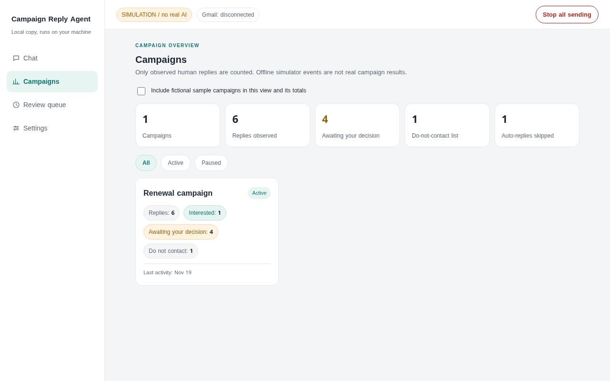
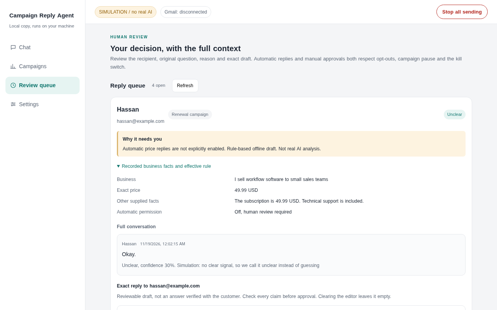

# Campaign Reply Agent

### Turn campaign replies into clear, reviewable next steps.

A local-first workspace for a single operator to sort email replies, review the full conversation, edit a response and keep a record of the decision. Narrow automatic price replies are optional and off by default.

**Built as a portfolio prototype, not an unattended production sales system.** The included experience runs in offline simulation with fictional people and messages. Real Gmail, real model behavior and actual delivery have not been tested end to end.



[Watch the detailed walkthrough](media/campaign-reply-agent-demo.mp4) · [Video chapters and transcript](media/README.md) · [Technical guide](docs/TECHNICAL-GUIDE.md) · [Repair history](REPAIR-NOTES.md)

## The problem it solves

Campaign replies arrive with different needs. One person asks the price, another wants a discount, someone asks to stop, and another says to try next month. Handling all of them as one generic reply risks sending the wrong answer or missing an important decision.

This project keeps the original message, the facts you supplied and the proposed next step together. It is designed to help you:

- Spend less time switching between a conversation, your notes and a draft.
- See which questions need your judgment, rather than letting an uncertain answer go out.
- Review and approve the exact words, with the recipient and thread in view.
- Record stop requests across local campaigns and block later local approvals for that address.
- See what was recorded, what failed and what still needs attention.

These are workflow goals, not measured time-saving or revenue claims. The project does not send a campaign, schedule follow-ups, or prove conversion lift.

## See it working

The video is an English, calmly narrated walkthrough of the actual local interface, with a light original music bed. It includes setup, explicit rules, simulated inbound replies, exact draft review, visible failure handling, stale-context protection, small-phone threads, Settings and the changes since the earlier demo.

**Video:** [`media/campaign-reply-agent-demo.mp4`](media/campaign-reply-agent-demo.mp4)

The optional Gmail/model/MCP setup is explained separately from what is shown running. There is no live account connection in the footage. Narration is AI-generated, not a human voice actor. The edit uses actual interface interactions, focused closeups and short one-point explainer cards so explanations remain readable. Captions and the full script are included beside the video.

## What is included

| Area | What you can do locally |
| --- | --- |
| Business setup | Answer one question at a time, save facts and an exact price/currency, review the summary, and resume the correct step after refresh. |
| Campaign overview | Inspect observed replies, decisions waiting and distinct do-not-contact addresses; include fictional samples only when selected. |
| Review queue | Read the full local conversation and reason, inspect supplied facts, edit the exact draft, then approve or reject it. |
| Explicit boundaries | Keep review-only as the default; optionally grant a narrow price-only rule. Campaign pause and the global switch block new send attempts. |
| Stop and freshness gates | Apply recognized current stop requests across local campaigns, cancel pending drafts, and block approval of drafts overtaken by newer customer context. |
| Durable outcomes | Record a send identity before the attempt, prevent concurrent double approval, and hold uncertain outcomes rather than blindly retrying. |
| Operator controls | Inspect worker health, manual follow-up requests, decision history and daily snapshots. |
| Optional integrations | Gmail worker, provider-backed review drafts and a small read-only MCP interface are implemented, with fake-contract coverage, not live E2E proof. |



## Install from a fresh copy

### Prerequisites

- Linux/WSL, or a compatible Unix environment with **Bash 4.3+**. Linux was tested; other systems were not.
- **Python 3.11+** with `venv` support, and **Node.js 20.9+** with `npm`. Python 3.12 is recommended. Local verification used Python 3.10.12 and Node 22.23.5; the Google libraries emit support warnings under Python 3.10. Recommended Python 3.11/3.12 have not been independently verified here.
- Internet access for the initial dependency installation. No accounts, keys or model usage are needed for the offline demo after installation.
- Ports **8791** and **8792** available on your own machine.

### 1. Open the source folder

Unzip the supplied repository archive and open a terminal in its `campaign-reply-agent` folder:

```bash
cd campaign-reply-agent
```

No GitHub repository is published with this package, so there is no clone URL to substitute or guess. If the owner publishes it later, clone that actual repository and enter its root folder before continuing.

### 2. Start in simulation mode

```bash
bash run.sh
```

On a fresh copy, no `.env` is needed. The script creates `.venv`, installs the pinned Python snapshot, runs `npm ci`, builds the frontend, and starts both services. The first run can take a few minutes.

Open **http://127.0.0.1:8792** in your browser. The backend is **http://127.0.0.1:8791**. Both bind to loopback only. Keep them that way: this is not an authenticated shared service.

Press **Ctrl+C** in the startup terminal to stop both services. Local settings and fictional demo records remain under the gitignored `data/` folder. A fresh archive contains no runtime database, `.env`, credentials or saved accounts.

### 3. Walk through a complete local decision

1. In **Chat**, describe your business. For the facts, try `The subscription is 49.99 USD. Technical support is included.`
2. When asked for the exact price, enter `49.99 USD`. Describe a campaign, for example `Renewal campaign, goal: renewals, first reminder then renewal offer then follow-up call`.
3. Choose a tone and write `Drafts only` as your permission note. Check the summary and leave the separate automatic-price checkbox off.
4. Open **Campaigns** and click **Simulate next inbound reply**. Repeat to bring in the next fictional case.
5. Open **Review queue**. Read the conversation and reason, open the recorded facts, edit the draft, then approve the exact reply or reject it.
6. Read the receipt. In simulation, a successful approval is a local record only, not an email send. Look at decision history and manual follow-up requests.
7. Open **Settings** to inspect the effective rule and optional connections. Editing facts revokes automatic permission until reconfirmed.

Simulation labels stay visible. Offline classification is a deterministic keyword rule system, not real AI analysis. Its confidence values are rule scores, not calibrated probabilities.

## How it is put together

```text
Fictional simulator or optional Gmail worker
                    |
                    v
Full local conversation + newest authored reply
                    |
                    v
Classify -> suppression / campaign / freshness / fact gates
                    |
       +------------+-------------+
       |                          |
Narrow explicit rule       Human review queue
       |                   exact editable draft
       +------------+-------------+
                    |
                    v
Durable attempt identity -> outcome / unresolved state
```

- **Frontend:** Next.js/React and TypeScript.
- **Backend:** FastAPI, Python and SQLite.
- **Storage:** local SQLite database, durable inbound/outbound states and decision records.
- **Optional worker:** Gmail API plus Cloud Pub/Sub pull subscription, with one configured label mapped to one explicitly selected campaign.
- **Optional model:** supported OpenAI or Anthropic configuration, with review-only drafting. Invalid provider values fail closed before a model request.
- **Optional MCP:** local stdio inspection tools for campaigns, queue, digest and threads. No send tool and no automatic authority grant.

See [the technical guide](docs/TECHNICAL-GUIDE.md) for component startup, environment values, OAuth setup, worker behavior, recovery and the implementation boundaries.

## What changed since the earlier demo

- Explicit permission, exact currency/decimal validation, full-context review and edited-body approval.
- Visible local errors and receipts, duplicate-approval protection, stale-context blocking and uncertain-attempt holds.
- Authored-versus-quoted email handling for the tested Outlook, Gmail, Thunderbird, plain and Arabic cases. This includes wrapped attribution and bottom/inline replies. It is not a universal email parser.
- Setup refresh/retry, keyboard-operable thread disclosures and readable expanded reasons at small phone widths.
- Distinct cross-campaign stop counts, accurate displayed history, useful not-found states and MCP unresolved-action parity.

[REPAIR-NOTES.md](REPAIR-NOTES.md) maps the repair rounds and limitations. The product code is frozen at the independently reviewed candidate 7; this package adds documentation and media, not more automatic behavior.

## Run the checks

After the first startup has installed the Python environment:

```bash
.venv/bin/python -m pytest backend/tests -q
```

Stop the normal app before browser acceptance so its ports are free:

```bash
cd frontend
npx playwright install chromium
npm run test:ui
```

On some Linux hosts, Playwright may also need browser system libraries installed by the machine's administrator. The acceptance suite builds the UI, uses an isolated temporary database, forces real Gmail/model access off, checks the five pages at 320/390/1280 widths, exercises keyboard/expanded views and onboarding failure recovery, saves evidence, and stops its own services.

**Verification snapshot:** 153 backend tests passed. Independent local review passed its agreed consent/regression matrix, clean startup, build/typecheck and browser checks. All external sends/provider calls in these tests are fake. Verification covered Python 3.10.12/Node 22.23.5 on one Linux environment, not every supported version or operating system.

## Honest limits before real use

- **Not live E2E tested:** Gmail OAuth/watch renewal, real model output, real destinations/threading and recipient delivery need a separately approved controlled test-inbox trial.
- **Not a campaign sender:** the local stop list does not control an unrelated source sender. Stop that sender separately. Manual follow-up tasks do not schedule or send anything.
- **Not perfect consent parsing:** formats and languages vary. Inspect ambiguous messages. No finite fixture matrix proves every current stop or quoted footer is recognized correctly.
- **Not a factual guarantee:** a model can write unsupported claims even when its output schema and fact-key references pass. Verify drafts before approval.
- **Not a team service:** no shared authentication, RBAC, multi-operator identity or hosted security controls. Protect the machine and local token/data files. Do not expose the ports.
- **Not a delivery receipt:** Gmail acceptance is not recipient delivery/read confirmation. A pause/stop switch cannot recall a request already in flight.
- **Not a compliance certification:** consent, jurisdiction, retention/deletion, backups and operational ownership still need their own review.

Do not enable real automatic sending on customer traffic on the strength of this demo alone.

## Troubleshooting

| Symptom | Next check |
| --- | --- |
| `python3 -m venv` fails | Install your OS's Python virtual-environment support, then rerun `bash run.sh`. |
| Node version/build error | Check `node --version` and use Node 20.9+; the tested version was 22.23.5. |
| Port already in use | Stop an earlier app or acceptance run before starting another. |
| Chat cannot load setup | Use **Retry loading setup**. Input stays disabled until the correct question is recovered. |
| Model configuration error | Use only a supported provider with your own local key, or unset both to return to offline mode. No provider typo fallback is allowed. |
| Send outcome uncertain | Inspect the original attempt's exact identity in Gmail. Do not resend just because a search returned no result. |

## Repository map

```text
backend/                FastAPI, engine, SQLite, optional integrations and tests
frontend/               Next.js interface and isolated browser acceptance
simulator/              Fictional inbound-reply sequence
docs/TECHNICAL-GUIDE.md  Detailed setup, worker and recovery notes
media/                  Detailed video, captions, transcript and screenshots
REPAIR-NOTES.md         Repair history and remaining boundaries
.env.example            Optional local configuration template, no secrets
run.sh                  Local startup and cleanup
```

## Sharing and license

This repository is released under the MIT License. See [LICENSE](LICENSE). Dependency licenses remain their own.
